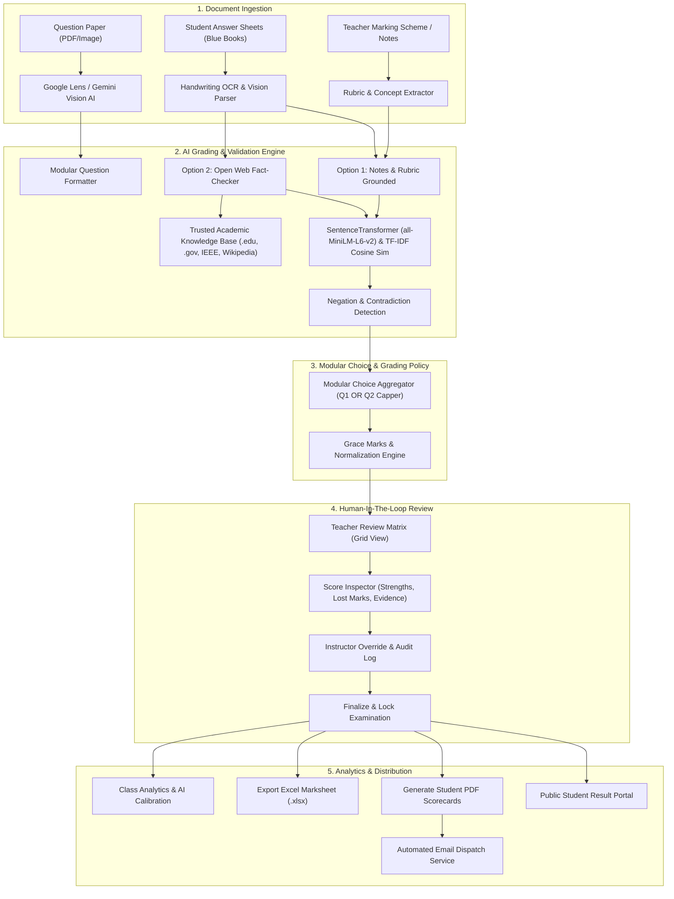

<div align="center">

# 🎓 SmartGrade / EvalAI
### *Next-Generation AI-Assisted Examination Assessment Platform with Full Teacher Authority*

[](https://fastapi.tiangolo.com/)
[](https://react.dev/)
[](https://vitejs.dev/)
[](https://tailwindcss.com/)
[](https://ai.google.dev/)
[](https://www.sbert.net/)
[](https://opensource.org/licenses/MIT)

<p align="center">
  <b>SmartGrade (EvalAI)</b> is an intelligent, high-accuracy examination grading platform built for modern universities and schools. It bridges the gap between traditional manual grading fatigue and opaque automated grading by implementing a <b>Human-in-the-Loop</b> architecture where AI acts as a transparent grading co-pilot while instructors maintain 100% final authority.
</p>

[Key Features](#-key-features) •
[Dual Grading Engines](#-dual-intelligent-grading-engines) •
[Architecture](#-system-architecture) •
[Quick Start](#-quick-start-guide) •
[API Reference](#-api-documentation) •
[Tech Stack](#-technology-stack) •
[Demo Credentials](#-pre-seeded-demo-credentials)

---

</div>

## 📌 Table of Contents

- [Overview & Philosophy](#-overview--philosophy)
- [Key Features](#-key-features)
- [Dual Intelligent Grading Engines](#-dual-intelligent-grading-engines)
  - [Option 1: Notes & Rubric-Grounded (Moderate Correction)](#option-1-notes--rubric-grounded-evaluation-moderate-correction)
  - [Option 2: Open Web-Search Validated (Lenient Correction)](#option-2-open-web-search-validated-evaluation-lenient-correction)
- [University Modular "OR" Choice Engine](#-university-modular-or-choice-engine)
- [System Architecture](#-system-architecture)
- [Project Directory Structure](#-project-directory-structure)
- [Technology Stack](#-technology-stack)
- [Quick Start Guide](#-quick-start-guide)
  - [Prerequisites](#prerequisites)
  - [1. Clone the Repository](#1-clone-the-repository)
  - [2. Backend Setup](#2-backend-setup)
  - [3. Frontend Setup](#3-frontend-setup)
  - [4. Running the Dev Servers](#4-running-the-dev-servers)
- [Configuration & Environment Variables](#-configuration--environment-variables)
- [Pre-Seeded Demo Credentials](#-pre-seeded-demo-credentials)
- [API Documentation](#-api-documentation)
- [Testing](#-testing)
- [Roadmap & Contributing](#-roadmap--contributing)
- [License](#-license)

---

## 💡 Overview & Philosophy

Grading university examinations is one of the most time-consuming, subjective, and error-prone responsibilities of academic staff. Standard automated graders frequently suffer from three major shortcomings:
1. **Opaque Black-Box Scoring:** Students receive arbitrary numbers with no explanation.
2. **Inflexible Rigidity:** Students expressing correct intuition with different vocabulary get penalised.
3. **Loss of Instructor Control:** Teachers cannot easily inspect, dispute, or override AI outputs.

**SmartGrade / EvalAI solves this by enforcing the following core principles:**

* **Teacher-in-the-Loop Authority:** AI produces detailed diagnostic proposals, but instructors retain immediate one-click override capability with complete immutable audit trails.
* **Multimodal Script Transcription:** Google Lens / Gemini Vision AI transcribes handwritten student blue books, mathematical derivations, ASCII/markdown tables, and diagram labels.
* **Dual Grading Paradigms:** Supports both structured syllabus grading (with instructor marking schemes) and open-ended exploratory grading (with autonomous web fact-checking).
* **Real-World University Compatibility:** Built-in support for modular choice formats (e.g. *"Answer any 1 out of 2 questions per module"*), capping scores to prevent over-marking while fairly awarding the best attempt.

---

## ✨ Key Features

### 1. 👁️ Google Lens & Gemini Vision AI Ingestion
- Upload exam question papers as PDF, JPG, PNG, or WEBP.
- Gemini 2.5 Flash / Google Lens automatically identifies:
  - Question numbers, sub-parts (e.g., `1a`, `1b`), and allocated marks.
  - Complex tables, mathematical formulas, and diagram requirements.
  - Automatic regrouping into sub-questions or main question blocks.
- Transcribes student handwritten exam answer sheets (blue books) with step-by-step mathematical reasoning.

### 2. ⚖️ Dual Intelligent Grading Modes
- **Option 1 (Notes & Rubric-Grounded):** Moderate, balanced correction using teacher notes and concept-level rubric extraction.
- **Option 2 (Web Search Fact-Validated):** Lenient, student-friendly correction searching trusted academic and educational sources with zero instructor answer key required.

### 3. 🏛️ University Modular "OR" Choice Handling
- Automatically parses modular question structures:
  - *Module 1: Q1 or Q2 (Max 20 Marks)*
  - *Module 2: Q3 or Q4 (Max 20 Marks)*
  - *Module 3: Q5 or Q6 (Max 20 Marks)*, etc.
- Prevents double-marking: if a student attempts both optional questions, the system evaluates both, caps the module score at the allowed maximum, and credits the student’s highest-scoring performance.
- Supports configurable grace marks distribution.

### 4. 🔬 Teacher Review Matrix & Score Inspector
- Full interactive grid view displaying students alongside questions.
- **Deep-Dive Score Inspector Modal:**
  - AI Confidence Rating (0–100%).
  - Detailed list of identified **Strengths**.
  - Flagged **Missed Concepts** and **Lost Marks Rationale**.
  - Actionable **Improvement Suggestions**.
  - **Contradiction & Negation Detection:** Identifies logical fallacies or direct factual inversions.
  - **Web Reference Citations:** View external URL citations and verified evidence snippets.
- One-click mark overrides with reason tracking and immutable audit logs.
- Formal Exam Finalization and lock state to prevent tamper.

### 5. 📊 Class Analytics & Calibration
- Score distribution histogram (Grade bands: A+, A, B, C, F).
- Pass/Fail rates and class averages.
- Question discrimination and difficulty indices.
- **AI Calibration Benchmark:** Measures Mean Absolute Deviation between AI scores and instructor overrides to evaluate model fidelity.
- High-risk student alerts (low OCR confidence, extreme deviations).

### 6. 📑 Reports, Exports & Student Communication
- **Excel Marksheets:** One-click generation of formatted `.xlsx` class grade summaries with question-by-question breakdown.
- **PDF Scorecards:** Publication-quality student diagnostic reports generated via ReportLab with strengths, improvement advice, and breakdown.
- **Automated Email Dispatch:** Bulk or individual delivery of official PDF scorecards directly to student email inboxes.

### 7. 🎓 Public Student Portal
- Zero-login result lookup via Roll Number and Exam Code.
- Direct student upload portal for submitting scanned answer scripts with real-time submission confirmation.

---

## 🧠 Dual Intelligent Grading Engines

| Feature | Option 1: Notes & Rubric-Grounded | Option 2: Open Web-Search Validated |
| :--- | :--- | :--- |
| **Inputs Required** | Question Paper + Student Script + **Teacher Notes / Rubric** | Question Paper + Student Script **ONLY** |
| **Evaluation Basis** | Concept-by-concept rubric criteria & teacher scheme | Online academic knowledge base & live web verification |
| **Correction Style** | **Moderate ("Not too strict")** — balanced partial credit | **Lenient ("Student-friendly")** — rewards intuition & keywords |
| **Semantic Model** | SentenceTransformer (`all-MiniLM-L6-v2`) + TF-IDF | Semantic Similarity + Web Evidence Matching |
| **Fact Verification** | Instructor ground truth | Trusted domains (`.edu`, `.gov`, Wikipedia, GeeksforGeeks, etc.) |
| **Best Used For** | Standard university semester exams, departmental mid-terms | Open-book tests, competitive assessments, dynamic essay exams |

### Option 1: Notes & Rubric-Grounded Evaluation (Moderate Correction)
1. **Concept Decomposition:** Breaks each question into weighted rubric items with target keywords.
2. **Semantic Affinity:** Computes cosine similarity between student response embeddings and rubric concepts:
   $$\text{Score} = \max\left(0.55 \cdot \text{Sim}_{\text{embedding}} + 0.45 \cdot \text{Overlap}_{\text{keyword}}, \; 0.80 \cdot \text{Sim}, \; 0.80 \cdot \text{Overlap}\right)$$
3. **Contradiction Detection:** Evaluates antonym flips and negation phrases (e.g. *"deadlock does not require circular wait"*). Deducts moderate marks (20%) on explicit contradiction.
4. **Fair Curve:**
   - $\ge 0.42$ affinity $\rightarrow$ **100% marks**
   - $\ge 0.28$ affinity $\rightarrow$ **85% marks**
   - $\ge 0.14$ or key terms present $\rightarrow$ **65% marks**

### Option 2: Open Web-Search Validated Evaluation (Lenient Correction)
1. **Autonomous Knowledge Retrieval:** Queries offline cached knowledge repositories and live academic domains (`ieee.org`, `britannica.com`, `geeksforgeeks.org`, etc.).
2. **Intuitive Understanding Curve:** Evaluates whether the student grasp fundamental principles, even if phrasing is casual or concise.
3. **Generous Scoring:**
   - High affinity ($\ge 0.22$) or key terms $\rightarrow$ **95% – 100% marks**
   - Moderate affinity ($\ge 0.12$) or foundational keywords $\rightarrow$ **80% – 90% marks**
   - Foundational intuition ($\ge 0.05$ or 6+ relevant words) $\rightarrow$ **65% – 75% marks**
   - Basic attempt $\rightarrow$ **40% – 50% marks**

---

## 🏛️ University Modular "OR" Choice Engine

In universities following modular curricula (such as VTU, Mumbai University, Anna University, etc.), exams are organized into 5 Modules with internal choice:

$$\text{Total Max Marks} = \sum_{m=1}^{5} \max\left(\text{Marks}(Q_{2m-1}), \;\text{Marks}(Q_{2m})\right) = 5 \times 20 = 100$$

SmartGrade automatically infers modular associations from question labels (e.g. `Module 1: Q1 or Q2`, `Q3a`, `Q3b`), calculates the effective maximum marks taking the choice into account, and caps module-wise totals so students who attempt both options are fairly credited for their best performance without receiving illicit extra marks.

---

## 🏗️ System Architecture



---

## 📁 Project Directory Structure

```text
ai-evaluation/
├── backend/
│   ├── app/
│   │   ├── models/              # SQLAlchemy 2.0 ORM Models
│   │   │   ├── audit.py         # Teacher override audit trails
│   │   │   ├── exam.py          # Exam metadata and grading mode
│   │   │   ├── question.py      # Questions & Rubric items
│   │   │   ├── submission.py    # Student submissions & blue books
│   │   │   ├── evaluation.py    # Question scores, strengths, evidence
│   │   │   └── user.py          # User authentication accounts
│   │   ├── routers/             # FastAPI Endpoint Routers
│   │   │   ├── auth.py          # JWT login & registration
│   │   │   ├── exams.py         # Exam creation & configuration
│   │   │   ├── questions.py     # Question parsing & Google Lens status
│   │   │   ├── submissions.py   # Script uploads & batch processing
│   │   │   ├── grading.py       # AI grading execution pipeline
│   │   │   ├── review.py        # Review matrix & score override endpoints
│   │   │   ├── analytics.py     # Class statistics & calibration benchmarks
│   │   │   ├── reports.py       # Excel/PDF reports & email triggers
│   │   │   ├── student_portal.py# Public student lookup & submission
│   │   │   └── seed_demo.py     # Comprehensive realistic demo seeding
│   │   ├── services/            # Core Assessment Logic
│   │   │   ├── ai_grader.py     # Dual-mode AI scoring engine
│   │   │   ├── gemini_vision_parser.py # Google Lens & Gemini Vision AI
│   │   │   ├── web_validator.py # Academic web fact-checking & citations
│   │   │   ├── module_evaluator.py # University Modular OR choice logic
│   │   │   ├── rubric_extractor.py # Marking scheme rubric parser
│   │   │   ├── question_parser.py  # Local fallback QP parser
│   │   │   ├── export_service.py   # OpenPyXL & ReportLab generators
│   │   │   ├── email_service.py    # Transactional PDF email sender
│   │   │   └── analytics_service.py# Statistical analytics engine
│   │   ├── schemas/             # Pydantic 2.0 request/response schemas
│   │   ├── utils/               # Text processing, tokenization, contradictions
│   │   ├── config.py            # System configuration & file paths
│   │   ├── database.py          # Database engine and session factory
│   │   └── main.py              # Application entrypoint & CORS setup
│   ├── tests/
│   │   └── test_smartgrade.py   # Pytest suite for grading & logic
│   ├── setup_pc_exam.py         # Parallel Computing VTU demo seed script
│   ├── setup_ml_exam.py         # Machine Learning university demo seed script
│   ├── requirements.txt         # Python dependencies
│   └── smartgrade.db            # SQLite local database (auto-generated)
│
├── frontend/
│   ├── src/
│   │   ├── api/
│   │   │   └── client.js        # Axios API client with auth interceptors
│   │   ├── components/          # Reusable UI Components
│   │   │   ├── Navbar.jsx       # Header navigation & role toggle
│   │   │   ├── Badge.jsx        # Status and grading mode badges
│   │   │   ├── Modal.jsx        # Glassmorphic modal dialogue
│   │   │   └── ScoreInspector.jsx # Deep-dive question score modal
│   │   ├── context/
│   │   │   └── AuthContext.jsx  # JWT state & persistent session provider
│   │   ├── pages/               # Primary Route Views
│   │   │   ├── Dashboard.jsx    # Exam cards, stats & quick actions
│   │   │   ├── ExamWizard.jsx   # 3-Step Exam Creation & Lens Parser
│   │   │   ├── SubmissionsPage.jsx # Student Blue Book upload management
│   │   │   ├── GradingConsole.jsx  # Run AI grading pipeline
│   │   │   ├── ReviewMatrix.jsx    # Teacher Review Grid & Override logs
│   │   │   ├── AnalyticsDashboard.jsx # Recharts charts & AI calibration
│   │   │   ├── ReportsPage.jsx     # Excel, PDF scorecards & Email dispatch
│   │   │   ├── StudentPortal.jsx   # Public student score lookup & upload
│   │   │   └── LoginPage.jsx       # Teacher login & quick demo access
│   │   ├── App.jsx              # Main routing view coordinator
│   │   └── index.css            # Custom CSS & Tailwind 4 design system
│   ├── package.json             # NPM dependencies & scripts
│   └── vite.config.js           # Vite build configuration
│
└── README.md                    # Project documentation
```

---

## 🛠️ Technology Stack

| Layer | Technologies |
| :--- | :--- |
| **Frontend Framework** | [React 19](https://react.dev/), [Vite 8](https://vitejs.dev/) |
| **Styling & Icons** | [Tailwind CSS v4](https://tailwindcss.com/), [Lucide React](https://lucide.dev/) |
| **Data Visualization** | [Recharts 3.x](https://recharts.org/), Canvas-Confetti |
| **Backend Framework** | [FastAPI](https://fastapi.tiangolo.com/) (Python 3.10+), [Uvicorn](https://www.uvicorn.org/) |
| **Database & ORM** | [SQLAlchemy 2.0](https://www.sqlalchemy.org/), SQLite / PostgreSQL compatible |
| **Vision & Multimodal AI**| [Google GenAI SDK](https://github.com/google/generative-ai-python) (`gemini-2.5-flash` / Google Lens) |
| **Natural Language Processing** | [Sentence-Transformers](https://www.sbert.net/) (`all-MiniLM-L6-v2`), [Scikit-Learn](https://scikit-learn.org/) |
| **Document Processing** | PyPDF 4, python-docx, Pillow, PyTesseract (Fallback OCR) |
| **Document Generation** | [ReportLab](https://www.reportlab.com/) (PDFs), [OpenPyXL](https://openpyxl.readthedocs.io/) (Excel) |
| **Security & Auth** | OAuth2 Bearer, [python-jose](https://python-jose.readthedocs.io/) (JWT), Passlib (Bcrypt) |

---

## 🚀 Quick Start Guide

### Prerequisites
- **Python**: Version `3.10` or higher
- **Node.js**: Version `18.x` or higher
- **Git**
- *(Optional)* **Tesseract OCR** (for offline image fallback if not using Gemini Vision)

---

### 1. Clone the Repository

```bash
git clone https://github.com/thorgnt12/Ai-Evaluation.git
cd Ai-Evaluation
```

---

### 2. Backend Setup

```bash
# 1. Navigate to backend directory
cd backend

# 2. Create a virtual environment
python -m venv venv

# Activate on Windows:
venv\Scripts\activate
# Or activate on Linux/macOS:
# source venv/bin/activate

# 3. Install dependencies
pip install -r requirements.txt

# 4. (Optional) Set your Google Gemini API Key for Google Lens extraction
# Create a .env file inside backend/ or set environment variable:
# Windows PowerShell:
$env:GEMINI_API_KEY="your-gemini-api-key-here"
# Linux/macOS:
# export GEMINI_API_KEY="your-gemini-api-key-here"
```

> **Note on AI Fallbacks:**
> If no Gemini API key is provided, SmartGrade seamlessly operates using its built-in NLP semantic embeddings (`all-MiniLM-L6-v2`), TF-IDF cosine similarity, and curated academic reference knowledge bases.

---

### 3. Frontend Setup

```bash
# 1. Navigate to frontend directory
cd ../frontend

# 2. Install dependencies
npm install
```

---

### 4. Running the Dev Servers

Open two terminal windows:

#### Terminal 1: Backend
```bash
cd backend
# Make sure virtual environment is activated
uvicorn app.main:app --reload --host 127.0.0.1 --port 8000
```
* Backend API will start at: `http://127.0.0.1:8000`
* Interactive API Documentation (Swagger UI): `http://127.0.0.1:8000/docs`

#### Terminal 2: Frontend
```bash
cd frontend
npm run dev
```
* Frontend Application will be accessible at: `http://localhost:5173`

> When the backend starts for the first time, it automatically creates the database schema and seeds realistic demonstration exams with pre-graded student answer sheets!

---

## ⚙️ Configuration & Environment Variables

Create a `.env` file in the `backend/` directory to configure custom parameters:

| Variable | Default Value | Description |
| :--- | :--- | :--- |
| `GEMINI_API_KEY` | *None* | Google GenAI API Key for Google Lens extraction of question papers and handwriting |
| `DATABASE_URL` | `sqlite:///smartgrade.db` | SQLAlchemy database connection URI (supports SQLite or PostgreSQL) |
| `SECRET_KEY` | `smartgrade-super-secret-jwt-key-2026-evalai` | Secret key for signing JWT tokens |
| `ACCESS_TOKEN_EXPIRE_MINUTES` | `1440` (24 Hours) | Lifespan of JWT authentication tokens |
| `TESSERACT_CMD` | `C:\Program Files\Tesseract-OCR\tesseract.exe` | Executable path for local Tesseract OCR fallback |
| `OCR_CONFIDENCE_THRESHOLD` | `0.0` | Minimum OCR confidence before flagging low-quality scans |

---

## 🔑 Pre-Seeded Demo Credentials

SmartGrade comes with out-of-the-box demonstration accounts and exams so you can explore the entire workflow without manual configuration:

### 👨‍🏫 Instructor / Teacher Login
- **Email:** `teacher@smartgrade.edu`
- **Password:** `teacher123`
- *Alternatively, click the **"Quick Demo Login"** button on the login screen.*

### 📚 Pre-Configured Demonstration Exams
1. **Operating Systems (`CS301-MID`)**:
   - Demonstrates **Option 1 (Notes & Rubric-Grounded Evaluation)** with moderate scoring.
   - Contains 5 enrolled students (Alice, Bob, Charlie, Diana, Ethan) with completed evaluations.
2. **Global Ecology & Climate Systems (`ENV204-FINAL`)**:
   - Demonstrates **Option 2 (Open Web-Search Fact Validation)** with lenient scoring.
   - Live citations from trusted sources (`wikipedia.org`, `britannica.com`).
3. **Parallel Computing (`BCS702`)**:
   - Demonstrates **VTU 5-Module "OR" Choice Handling** with actual handwritten Blue Book transcriptions (Student: Shadab P, USN: `1HK23CS090`).

### 🎓 Student Portal Test Rolls
- Exam Code: `CS301-MID` | Roll Number: `21CS001` (Alice Walker)
- Exam Code: `CS301-MID` | Roll Number: `21CS002` (Bob Smith)
- Exam Code: `BCS702` | Roll Number: `1HK23CS090` (Shadab P)

---

## 📖 API Documentation

SmartGrade exposes a RESTful API powered by FastAPI with auto-generated OpenAPI documentation available at `http://127.0.0.1:8000/docs`.

### Primary Endpoint Groups

| Method | Endpoint | Description |
| :--- | :--- | :--- |
| `POST` | `/api/auth/token` | Authenticate and obtain JWT access token |
| `GET` | `/api/exams/` | List all exams belonging to instructor |
| `POST` | `/api/exams/` | Create a new examination |
| `POST` | `/api/questions/parse-qp` | Parse question paper via Google Lens or fallback parser |
| `GET` | `/api/lens/status` | Check Gemini Vision AI / Google Lens status & active model |
| `POST` | `/api/lens/key` | Update Gemini Vision API key dynamically from frontend |
| `POST` | `/api/submissions/upload` | Upload student answer script (PDF/Image) |
| `POST` | `/api/grading/run/{exam_id}` | Trigger AI Grading Pipeline across all submissions |
| `GET` | `/api/review/matrix/{exam_id}` | Retrieve interactive teacher review matrix grid |
| `PUT` | `/api/review/override` | Save instructor override for a student score with audit logging |
| `POST` | `/api/review/finalize/{exam_id}` | Finalize examination and lock scores |
| `GET` | `/api/analytics/{exam_id}` | Retrieve class grade distribution, averages, and calibration |
| `GET` | `/api/reports/excel/{exam_id}` | Download generated Excel class marksheet |
| `GET` | `/api/reports/pdf/{submission_id}` | Download individual student diagnostic PDF scorecard |
| `POST` | `/api/reports/send-email` | Dispatch PDF scorecard via email to student |
| `POST` | `/api/portal/lookup` | Public student result lookup by roll number |
| `POST` | `/api/portal/submit` | Public student answer script submission |

---

## 🧪 Testing

The repository includes a comprehensive unit testing suite covering text cleaning, semantic similarity, negation/contradiction detection, rubric extraction, and scenario grading:

```bash
# From the backend directory:
pytest -v tests/test_smartgrade.py
```

### What the test suite validates:
- Question paper parsing and marks detection.
- Antonym contradiction & explicit negation detection (e.g. inverted deadlock conditions).
- Rubric concept extraction from syllabus notes.
- Option 1 (Notes-Grounded) score allocation and partial credit logic.
- Modular choice cap calculations.
- Excel marksheet and PDF scorecard generation.

---

## 🗺️ Roadmap & Contributing

- [x] Multimodal Question Paper extraction via Google Lens / Gemini Vision
- [x] Dual Grading Engines (Option 1 Notes vs Option 2 Web Search)
- [x] University Modular "OR" choice auto-capping
- [x] Teacher Review Matrix with immutable audit logs
- [x] Automated Excel marksheets & PDF diagnostic scorecards
- [x] Direct transactional email dispatch
- [x] Public Student Result & Submission Portal
- [ ] Multi-page handwritten batch splitting using QR code headers
- [ ] Audio feedback generation for visually impaired students
- [ ] Canvas LMS / Moodle LTI 1.3 integration

### Contributing
Contributions are welcome! If you'd like to contribute:
1. Fork the repository.
2. Create a feature branch (`git checkout -b feature/AmazingFeature`).
3. Commit your changes (`git commit -m 'Add some AmazingFeature'`).
4. Push to the branch (`git push origin feature/AmazingFeature`).
5. Open a Pull Request.

---

## 📄 License

This project is licensed under the **MIT License** — see the [LICENSE](LICENSE) file for details.

---

<div align="center">
  <sub>Built with ❤️ for educators and students. Powered by FastAPI, React 19 & Google Gemini Vision AI.</sub>
</div>